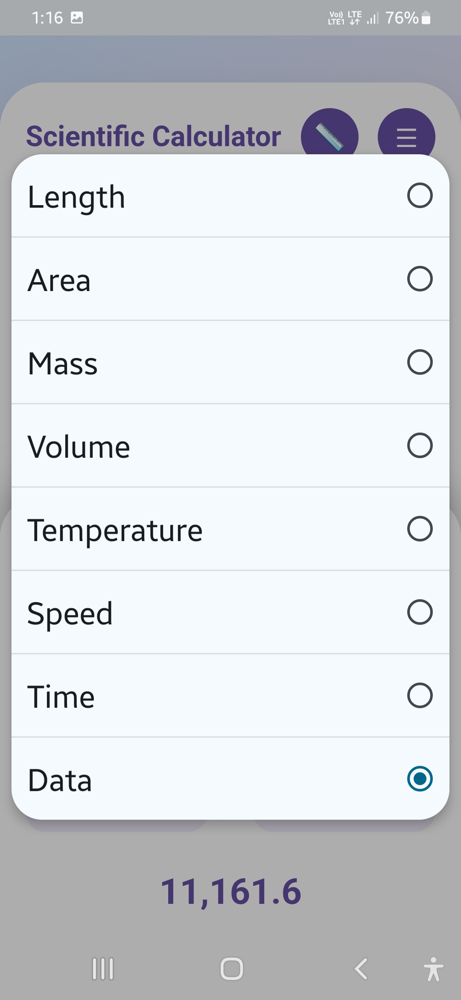
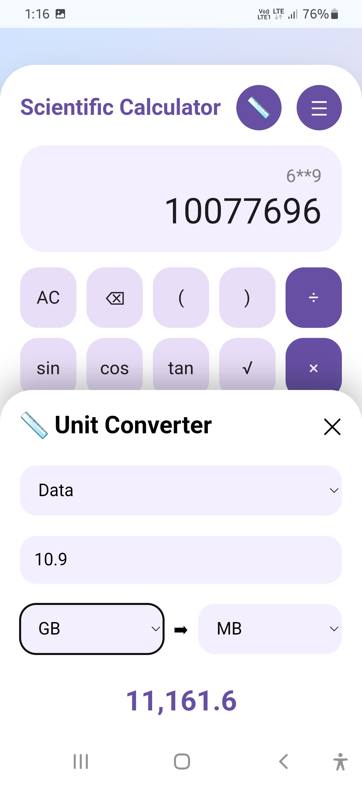

# 🌐 **[CalcuPress](https://divyanshkatiyar.github.io/Calcupress/)**

**Material-You Expressive Scientific Calculator & Unit Converter** built using **HTML, CSS, and JavaScript**.

 
 
 
 


### ⚠️ PROPRIETARY SOFTWARE 
**Copyright © 2026 Divyansh Katiyar. All Rights Reserved.**
> This software is strictly proprietary. Access is granted solely for personal evaluation and educational review; any unauthorized copying, modification, redistribution, or commercial use is legally prohibited under the full **[Proprietary Software & Copyright Notice](https://github.com/divyanshkatiyar/Calcupress/blob/main/LICENSE)**


---

<p align="left">
  
  
  
  
  
</p>

---

Calcupress combines an elegant **Material You**-inspired interface with powerful **scientific calculations** and an **all-in-one unit converter**, delivering a ⚡️ blazing-fast, lightweight, responsive, and user-friendly experience—all offline on any device 📥.
> No frameworks. No libraries. No dependencies.

---

### ⚙️ 𝐂𝐨𝐫𝐞 𝐅𝐞𝐚𝐭𝐮𝐫𝐞 𝐔𝐩𝐝𝐚𝐭𝐞𝐬

• 𝐃𝐢𝐟𝐟𝐞𝐫𝐞𝐧𝐭𝐢𝐚𝐥 & 𝐈𝐧𝐭𝐞𝐠𝐫𝐚𝐥 𝐂𝐚𝐥𝐜𝐮𝐥𝐮𝐬: Added support for both Indefinite & Definite Integrals ( ∫ ) alongside Differential Calculus (d/dx) operations, and trigonometric functions including inverse & hyperbolic
• 𝐂𝐨𝐦𝐩𝐥𝐞𝐱 𝐂𝐚𝐥𝐜𝐮𝐥𝐮𝐬 (a+ib) : Full complex number support — real & imaginary parts, polar/rectangular conversions (r , ∠θ), and phase angle evaluations im CMPLX mode
• 𝐌𝐚𝐭𝐫𝐢𝐱 & 𝐕𝐞𝐜𝐭𝐨𝐫 𝐀𝐥𝐠𝐞𝐛𝐫𝐚: Dedicated operations for matrix arithmetic, determinants, inverses, transpose, vector dot & cross products, nPr, nCr & n!
• 𝐄𝐪𝐮𝐚𝐭𝐢𝐨𝐧 𝐒𝐨𝐥𝐯𝐞𝐫: Multi-degree polynomial & system of linear equations
• 𝐕𝐚𝐫𝐢𝐚𝐛𝐥𝐞 & 𝐂𝐨𝐧𝐬𝐭𝐚𝐧𝐭 𝐀𝐬𝐬𝐢𝐠𝐧𝐦𝐞𝐧𝐭 𝐒𝐭𝐨𝐫𝐚𝐠𝐞: Save, manage, and recall custom variables & built-in physical constants across sessions
• 𝐃𝐞𝐝𝐢𝐜𝐚𝐭𝐞𝐝 𝐌𝐨𝐝𝐞 𝐒𝐰𝐢𝐭𝐜𝐡𝐞𝐫 𝐌𝐞𝐧𝐮: Quick-access navigation menu to toggle seamlessly between Scientific, Matrix/Vector, Complex, Calculus, and Unit Conversion
• 𝐃𝐞𝐠 / 𝐑𝐚𝐝 𝐌𝐨𝐝𝐞 𝐓𝐨𝐠𝐠𝐥𝐞: Instant angular unit switching with state indicators for trigonometric calculations
• 𝐒𝐡𝐢𝐟𝐭 𝐭𝐨𝐠𝐠𝐥𝐞 : Introduced shift button for instant switching between trignometric, inverse trignometric & hyperbolic functions like a physical calculator.

• 🧮 **Scientific Calculator**
- ➕ Basic arithmetic operations
- 📐 Trigonometric & inverse trignometric functions (sin, cos, tan
- √ Square root, modulus |x|, 
- Logarithm (log), Natural logarithm (ln), Exponents (xʸ), Factorial (!)
- (π) Pi constant, (e) Euler's constant
- Parentheses support

### 📏 Unit Converter

- 📏 Length
- 🟩 Area
- 🌡️ Temperature
- 🧪 Volume
- ⚖️ Mass
- 🚗 Speed
- ⏱️ Time
- 💾 Data Storage

### 🎨 Material 3 Expressive UI
- 🌗 Light & Dark Theme
- 📱  Auto-scalable multi-line display
- 💫 Responsive Design & Smooth Animations
- 🎯 Rounded Material Components
- ☰ Modern Menus 
- 🗑 Calculation History

---

## 📂 Project Structure

```
CalcuPress/
│
├── index.html
├── README.md
└── LICENSE
└── manifest.json
└── sw.js
```

---

## 🎯 Future Plans

- 📈 Graph Plotter
- 📊 Statistics Calculator
- 💱 Currency Converter
- 📅 Date Calculator
- 🧪 Programmer Mode
- 🧠 Equation Solver
- 📜 Calculation History
- ⌨️ Keyboard Shortcuts
- 🎙️ Voice Input

---

## 🤝 Contributing

Contributions, feature requests, and bug reports are always welcome!

If you'd like to improve CalcuPress, feel free to fork the repository and submit a pull request.

---

## 📄 License

Detailed license can be viewed **[here](https://github.com/divyanshkatiyar/Calcupress?tab=License-1-ov-file#)**.

---

## ⭐ Support

If you found this project useful, **consider giving it a ⭐** on GitHub to help the project reach more developers and motivate future improvements.

---
<div align ="center">
  
**Built on android phone 📱 using HTML, CSS & JavaScript.**
</div>
